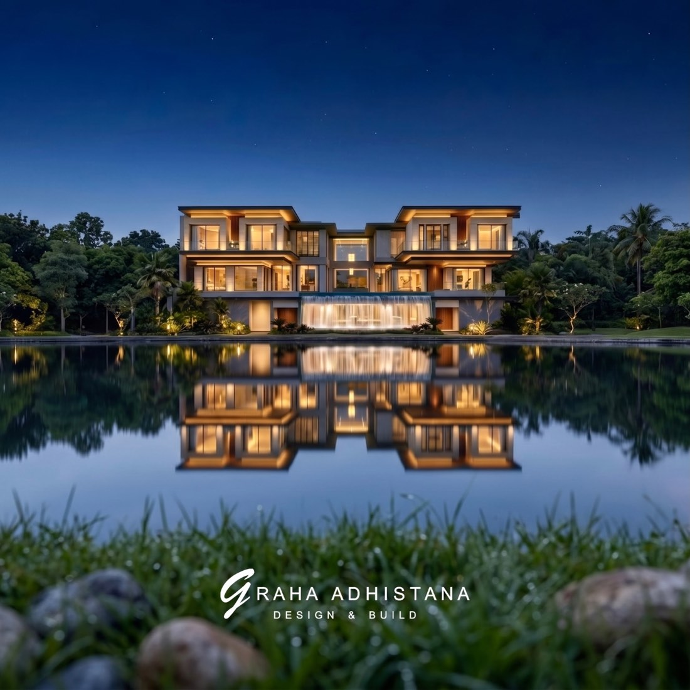

# Graha Adhistana — website brief (read fully before building a page)

Static site, no build step: plain HTML + the shared CSS/JS below. Open it via the local server at
`http://127.0.0.1:4321/`. Pages: `index.html` (home), `projects.html`, `project.html?p=<slug>`,
`services.html`, `about.html`, `contact.html`.

## 1. Facts — the only facts you may state

- **Name:** Graha Adhistana (Instagram/Threads `@graha.adhistana`). A design & build construction company.
- **Since 2002**, which makes 24 years in 2026. Their own captions say "over 20 years of expertise".
- **Base:** Pantai Indah Kapuk (PIK), Jakarta Utara. They build across PIK, PIK 2, Golf Island, Ebony Golf, Sonata Lagoon, Katamaran, Mediterania Boulevard and Manhattan PIK 2.
- **What they do** (all shown in their work):
  - architectural design
  - design & build (one team from design to construction)
  - interior design (dark marble lounges, home cinemas, bars, karaoke rooms)
  - general contracting for other architects. *Future House*, Jakarta: architect Angkasa Architects, general contractor Graha Adhistana.
  - commercial and leisure work. *Noble Padel*, PIK 2: over 10,000 m², which they call the largest padel facility in Indonesia. It has a sweeping curved roofline with a grand high ceiling, sits beside a lake with natural cool airflow, and has VIP lounges.
- **Styles:** modern tropical, contemporary (sharp lines meeting fluid curves), classic / neoclassical (French mansard roofs), and dark luxury interiors.
- **Contact:** WhatsApp / phone `+62 888 1010 688`, link `https://wa.me/628881010688`. They offer a free consultation; call it "complimentary".
- **Their own lines (OK to echo, lightly edited):**
  - "A timeless statement of elegance"
  - "Dark, sleek, refined. Crafted for subtle, timeless luxury."
  - "Serene haven by the water's edge"
  - "Peaceful shelter beneath open skies"
  - "A bold expression where sharp lines meet fluid curves"
  - "Tailored for the finest experience"
  - "Homes tailored to your needs"
- **Name meaning (allowed):** in classical Indian temple architecture the *adhiṣṭhāna* is the plinth, the base on which the whole temple rises. *Graha* means house.

**Never invent:** awards, clients, testimonials, project counts, team names, email addresses, a street address, floor areas (except Noble Padel), prices or guarantees. If a section seems to need such a fact, design it around the facts above instead.

## 2. Reduction rules (client direction: "remove all AI slop, unnecessary text, information and sections")

These override everything below.

- **Images carry the site.** Words appear only where they carry a fact: names, places, years, scope, contact.
- **Headings:** plain nouns or names ("Projects", "Services", "About", "Contact", "Interiors", "Earlier work", a project name). No slogans or taglines, no clever phrases, and no headings built as "phrase + *italic word*".
- **No explanatory paragraphs.** At most ONE short sentence on a page where it states a fact (e.g. what the company does).
- **Never use:** section index numbers (01, 02…), stats rows, process steps, FAQs, philosophy/values lists, "range"/"styles" recaps, collaborations recaps, maps, coordinates, "Drag"/"Scroll" hints, decorative captions repeating the alt text, or the same image twice on a page.
- **Labels:** 1–2 words. Links: "All projects", "Enquire", project names.

## 3. Voice

- English. Quiet confidence: short sentences, concrete nouns, material and light. Use no exclamation marks, no "dream home", no "best-in-class" and no superlatives, except the Noble Padel claim credited to the facility.
- Headlines run 2–7 words in sentence case, with at most ONE italic phrase using `<em>`. Examples: "Residences of *quiet* distinction", "Designed and built *as one*", "Every detail, *considered*".
- Body copy runs 1–3 sentences per block. Labels are 1–3 words.

## 3. Design system (shared files: do NOT edit them)

- `assets/css/style.css` holds the tokens and components. Put page-only styles in `assets/css/<page>.css`, linked after style.css.
- `assets/js/main.js` handles behaviour (header, menu, reveal, parallax, cursor label, hover preview, drag scroll, hero, preloader). Page logic goes in `assets/js/<page>.js`.
- `assets/js/projects.js` sets `window.GA_PROJECTS` (project data) and `window.GA` helpers.

**Palette.** Use the tokens in style.css (`var(--ink)` and the rest), never raw hex.
- `--ivory` is the page background. `--ink` is text and dark sections. `--stone` and `--paper` are alternate light surfaces.
- `--taupe` is muted text on light; `--mute` is muted text on dark.
- `--bronze` / `--bronze-soft` are the accent, for index numbers, thin lines and tiny details only, under 2% of the surface.
- Dark sections take the class `on-dark` (or `section--dark`).

**Type.** Cormorant Garamond for display, weight 300, italics for emphasis. Jost for UI and body.
- Classes: `.display`, `.h1` (one per page), `.h2`, `.h3`, `.h4`, `.lead` (serif paragraph), `.label` (tiny tracked caps), `.small`, `.muted`, `.body-copy` (max 34em), `.quote`, `.balance`.

**Layout.**
- `.wrap` (max 1680px, fluid gutters) and `.wrap--narrow` (1180px).
- `.grid` is 12 columns. Place items with page CSS (`grid-column: 2 / span 5`). The grid collapses to one column under 900px; handle mobile in page CSS.
- `.section` gives very generous vertical padding; `.section--tight` and `.section--flush-top` are the variants.
- One idea per screen. Use asymmetric compositions, unequal image sizes and big empty space. At least one full-bleed image per page with nothing on it.

**Rules.**
- Square corners and no shadows, pills, glass, gradients (image scrims only), emoji, icon sets, counters/count-ups, marquees, star ratings or avatar stacks.
- The only icon is the thin arrow: `<svg class="arr" viewBox="0 0 34 10" aria-hidden="true"><path d="M0 5h32M28 1l4 4-4 4" fill="none" stroke="currentColor"/></svg>`.

### Components (copy these patterns)

```html
<!-- section heading row -->
<div class="section-head" data-reveal>
  <span class="label section-head__index">01</span>
  <span class="label">Selected works</span>
  <a class="label link section-head__end" href="projects.html">All projects</a>
</div>

<!-- buttons / links -->
<a class="btn" href="contact.html">Book a consultation <svg class="arr" ...></svg></a>
<a class="btn btn--solid" href="...">...</a>
<a class="link label" href="...">View project <svg class="arr" ...></svg></a>

<!-- image with mask reveal (+ optional parallax, + hover zoom inside links) -->
<div class="media ratio-4x5 zoom" data-reveal="img" data-parallax="6">
  
</div>

<!-- project card -->
<a class="project-card" href="project.html?p=waterfront-mansion" data-cursor="View">
  <div class="media ratio-4x5 zoom" data-reveal="img"></div>
  <div class="project-card__meta">
    <span class="label project-card__index">01</span>
    <h3 class="project-card__title">Waterfront Mansion</h3>
    <span class="label project-card__info">PIK · 2026</span>
  </div>
</a>

<!-- numbered rows (services / process / index list); add data-preview="img.jpg" for a floating image on hover -->
<div class="rows">
  <a class="row-item" href="..." data-preview="assets/img/m/xx.jpg">
    <span class="label row-item__index">01</span>
    <span class="row-item__title">Design &amp; Build</span>
    <span class="row-item__text">...</span>
    <svg class="arr" ...></svg>
  </a>
</div>

<!-- stats (static numbers only) -->
<div class="stats"><div class="stat"><div class="stat__num">2002</div><div class="label stat__label">Established</div></div>...</div>

<!-- accordion -->
<div class="accordion"><details><summary>Question</summary><div class="accordion__body"><p>Answer</p></div></details></div>

<!-- form field -->
<div class="field"><label for="name">Name</label><input id="name" name="name" autocomplete="name" required><span class="field__error" aria-live="polite"></span></div>

<!-- inner page hero: image -->
<section class="page-hero">
  <div class="media" data-parallax="5"></div>
  <div class="wrap page-hero__content"> <span class="label">...</span> <h1 class="h1" data-split>...</h1> </div>
</section>
<!-- or text-only intro -->
<section class="page-intro wrap"> ... </section>
```

**Motion attributes** (main.js does the work; everything is visible without JS and under reduced motion):
- `data-reveal`: fade + 18px rise. `data-reveal="fade"`: fade only.
- `data-reveal="img"`: clip-path mask reveal; put it on `.media`. `data-reveal="line"`: a hairline draws in.
- `data-split`: masked word-by-word heading reveal. Use it ONLY on h1/h2 display headings, max ~8 words.
- `data-stagger="0.08"` on a parent staggers the children that carry data-reveal / data-split.
- `data-parallax="6"` on `.media` gives gentle image drift (percent). Images only, never text.
- `data-cursor="View"` shows the round "View" label on project imagery (desktop only).
- `data-preview="path.jpg"` shows a floating image preview on hover (desktop only).
- `style="--d:.2s"` sets a manual delay.

**Content rendered with JS.** main.js applies all of the above once, at load.
- If your page builds markup from `GA_PROJECTS`, include `projects.js` and your page script BEFORE `main.js` (deferred scripts run in order), so the markup exists when main.js starts.
- For markup you insert later (filters, view toggles), call `window.GAUI.refresh(containerEl)` afterwards; otherwise elements with `data-reveal` stay invisible.
- `data-cursor` is delegated and works everywhere.

## 4. Images

- Every image is in `assets/img/ig/` (full size, up to ~2600px) and `assets/img/m/` (1100px). Use `m/` for anything at or below half the viewport width, `ig/` for full-bleed.
- Choose images from `_source/catalog.md` (subject, quality, watermark, crop notes) and `assets/js/projects.js`. Prefer files marked clean (no watermark). Where an image has a bottom logo watermark, crop it out with the container ratio and `object-position` (e.g. `50% 30%`).
- Always set `width`/`height` (from the catalog / projects.js), descriptive `alt` text, and `loading="lazy" decoding="async"` below the fold. Use `fetchpriority="high"` for the first hero image.
- Never use an image with in-scene third-party logos (e.g. the Netflix TV renders) or byte-duplicates side by side.

## 5. Page skeleton (every page)

```html
<!doctype html>
<html lang="en">
<head>
  <meta charset="utf-8">
  <meta name="viewport" content="width=device-width, initial-scale=1">
  <title>[Page] — Graha Adhistana</title>
  <meta name="description" content="[one sentence]">
  <meta name="theme-color" content="#15130f">
  <meta property="og:title" content="[Page] — Graha Adhistana">
  <meta property="og:description" content="[one sentence]">
  <meta property="og:image" content="assets/img/ig/[hero].jpg">
  <link rel="icon" href="assets/img/favicon.svg" type="image/svg+xml">
  <link rel="apple-touch-icon" href="assets/img/apple-touch-icon.png">
  <link rel="preconnect" href="https://fonts.googleapis.com">
  <link rel="preconnect" href="https://fonts.gstatic.com" crossorigin>
  <link rel="stylesheet" href="https://fonts.googleapis.com/css2?family=Cormorant+Garamond:ital,wght@0,300;0,400;0,500;1,300;1,400&family=Jost:wght@300;400;500&display=swap">
  <link rel="stylesheet" href="assets/css/style.css">
  <link rel="stylesheet" href="assets/css/[page].css">
  <script>document.documentElement.classList.add('js');setTimeout(function(){if(!window.__ga)document.documentElement.classList.remove('js')},3000);</script>
</head>
<body data-page="[home|projects|services|about|contact]" data-header-theme="light">  <!-- data-header-theme="light" ONLY when the page starts with a dark full-bleed image -->
  <a class="skip-link" href="#main">Skip to content</a>
  <!-- header:start --><!-- header:end -->
  <main id="main">
    ...
  </main>
  <!-- footer:start --><!-- footer:end -->
  <script src="https://unpkg.com/lenis@1.1.13/dist/lenis.min.js" defer></script>
  <script src="assets/js/projects.js" defer></script>   <!-- only if the page uses project data -->
  <script src="assets/js/main.js" defer></script>
  <script src="assets/js/[page].js" defer></script>      <!-- optional -->
</body>
</html>
```

After writing the page, run `python3 tools/sync-partials.py` from the project root. It fills the header/footer blocks from `_partials/`; never hand-edit those blocks. The footer already contains a big closing CTA ("Let us build what endures.") on ink, so do not end your page with another CTA section of the same kind.

## 6. Quality bar

- **Accessibility:** one `<h1>`, landmarks, alt text, visible focus, 4.5:1 contrast for text, touch targets ≥ 44px, every form input labelled, and nothing conveyed by colour alone.
- **Responsive:** check 375px (no horizontal scroll, readable type, stacked layouts), 768px, 1280px and 1440px+.
- **Performance:** lazy images, explicit dimensions, no new libraries, no frameworks.
- **Copy:** no lorem ipsum. Proofread every word.
